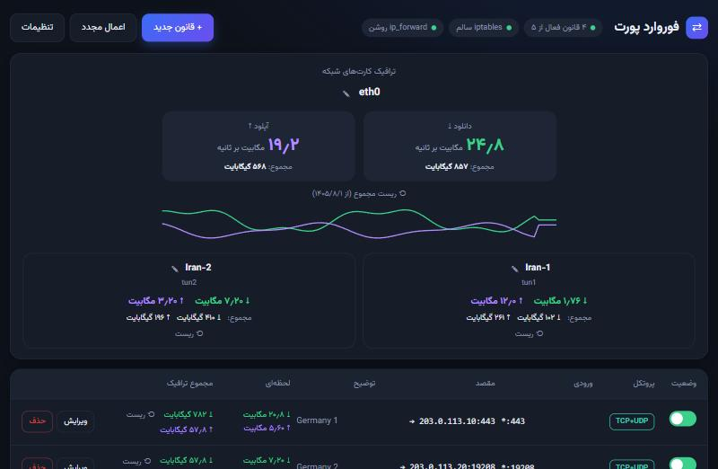
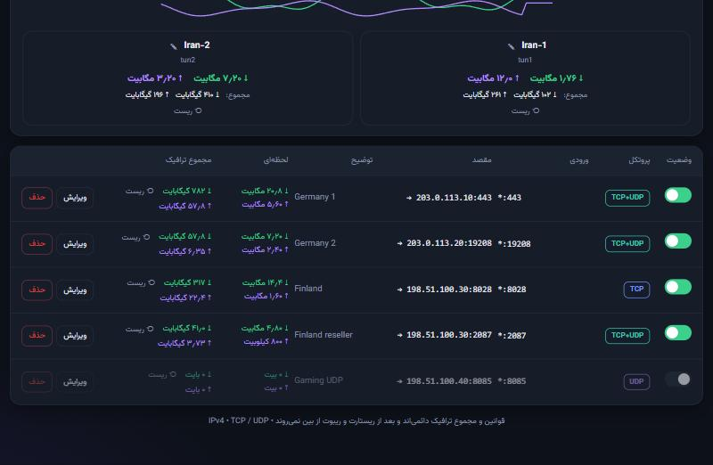
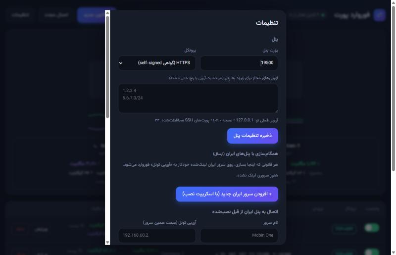

<div align="center">

# fwpanel

**پنل وب سبک برای فوروارد پورت با iptables**
TCP / UDP · ترافیک لحظه‌ای · تونل GRE6 · همگام‌سازی خودکار چند سرور

[English](README.en.md) · فارسی


</div>

---

## نصب (یک خط)

روی سرور (Debian / Ubuntu) به‌عنوان root:

```bash
bash <(curl -Ls https://raw.githubusercontent.com/soheilas/fwpanel/main/install.sh)
```

نصب‌کننده چند سؤال ساده می‌پرسد (پورت و پروتکل پنل)، پنل را نصب می‌کند و در پایان **آدرس و رمز** را چاپ می‌کند.
بعد از نصب دستور `fwpanel` برای مدیریت در دسترس است.

> سرور ایران به GitHub دسترسی ندارد؟ از [راه‌اندازی دو سرور](#راه‌اندازی-دو-سرور-خارج--ایران) استفاده کن؛ فایل‌ها از سیستم خودت روی SSH فرستاده می‌شوند.

## امکانات

| | |
|---|---|
| **فوروارد** | TCP، UDP یا هر دو · NAT قابل کنترل · روشن/خاموش · دائمی بعد از ریبوت |
| **ترافیک** | سرعت لحظه‌ای هر فوروارد و هر کارت شبکه + **مجموع ماندگار** با دکمه‌ی ریست |
| **چند سرور** | قانونی که روی سرور خارج می‌سازی، خودکار روی سرورهای ایران هم ساخته می‌شود |
| **تونل** | ساخت تونل GRE6 دائمی و پیدا کردن خودکار آدرس IPv6 سالم |
| **امنیت** | لیست آی‌پی مجاز · محدودیت تلاش ورود · HTTPS اختیاری · همگام‌سازی امضاشده با HMAC |
| **سبک** | یک فایل پایتون بدون وابستگی · حدود ۱۵ مگابایت رم |




## مدیریت: دستور `fwpanel`

```
fwpanel                 منوی مدیریت
fwpanel info            آدرس، پورت، پروتکل
fwpanel status | log    وضعیت و لاگ
fwpanel start | stop | restart
fwpanel password        رمز جدید
fwpanel port [N]        تغییر پورت پنل
fwpanel tls on|off      HTTPS / HTTP
fwpanel allow-clear     حذف لیست آی‌پی مجاز (اگر قفل شدی)
fwpanel update          آپدیت به آخرین نسخه
fwpanel uninstall       حذف
```

تنظیمات (پورت، HTTP/HTTPS، آی‌پی مجاز، رمز، پشتیبان‌گیری) از داخل خود پنل هم قابل تغییر است:



## راه‌اندازی دو سرور (خارج + ایران)

یک دستور، هر دو سرور را از صفر تا صد آماده می‌کند: نصب پنل روی هر دو، پیدا کردن IPv6 سالم، ساخت تونل،
اتصال همگام‌سازی و ساخت فورواردهای اولیه.

```bash
bash <(curl -Ls https://raw.githubusercontent.com/soheilas/fwpanel/main/scripts/setup-servers.sh) \
     --foreign 1.2.3.4 --iran 5.6.7.8 --key ~/.ssh/id_ed25519 \
     --rule 443=91.1.2.3 --rule 2087=65.1.2.3:2087
```

- روی هر لینوکس، WSL یا Git Bash با دسترسی SSH به سرورها (به‌عنوان root) اجرا می‌شود؛ `--key` را نده تا ssh خودش رمز را بپرسد.
- چند سرور ایران: `--iran` را تکرار کن. اجرا روی خود سرور خارج: `--foreign local`.
- `--no-tunnel` فوروارد را مستقیم روی اینترنت می‌برد (`--foreign-ip` اگر سرور پشت NAT است).
- سروری که از قبل از پنل دیگری قانون می‌گیرد بدون `--replace-key` دست‌کاری نمی‌شود.

بعد از آن، **قانون‌ها را فقط در پنل سرور خارج بساز**؛ روی سرورهای ایران خودکار ظاهر می‌شوند.
هر سرور ایران فقط از یک پنل خارج قانون می‌گیرد.

<details>
<summary>چطور کار می‌کند</summary>

```
کاربر ──► سرور ایران                            سرور خارج
          پورت X ──DNAT──► آی‌پی تونل:X ══GRE6══► پورت X ──DNAT──► مقصد نهایی
                    ▲                                  │
                    └── همگام‌سازی HMAC (هر تغییر + هر ۵ دقیقه) ◄┘
```

درخواست‌های همگام‌سازی با HMAC-SHA256 و زمان‌سنج ۱۲۰ ثانیه‌ای امضا می‌شوند؛ کلید روی شبکه نمی‌رود و روی HTTP هم قابل جعل نیست
(فقط محتوای قانون‌ها خوانا می‌ماند).
</details>

<details>
<summary>نصب بدون اینترنت / روی سرور ایران</summary>

از پنل سرور خارج: **تنظیمات ← افزودن سرور ایران جدید** یک اسکریپت نصب تک‌فایلی می‌سازد که پنل و (اختیاری) تونل را روی سرور ایران
نصب می‌کند و بدون GitHub کار می‌کند:

```bash
scp install-Iran-1.sh root@IRAN:/root/ && ssh root@IRAN 'bash /root/install-Iran-1.sh'
```
</details>

<details>
<summary>امنیت و نکات</summary>

- رمز با PBKDF2 (۲۰۰ هزار تکرار)؛ کوکی `HttpOnly` + `SameSite=Strict`؛ هدر CSRF
- روی HTTP رمز و کوکی رمزنگاری نمی‌شوند؛ برای پنل بازِ اینترنتی **آی‌پی مجاز** بگذار یا HTTPS بزن
- پورت ۲۲، پورت‌های sshd و پورت خود پنل اجازه‌ی فوروارد ندارند
- بعضی دیتاسنترها آدرس‌های IPv6 خودکار (SLAAC، شامل `ff:fe`) را بلاک می‌کنند؛ اسکریپت آدرس ثابت را ترجیح می‌دهد
- سرور پشت NAT: پورت پنل را روی NAT باز کن
- مجموع ترافیک هر ۳۰ ثانیه ذخیره می‌شود (قطع ناگهانی برق تا ۳۰ ثانیه آمار را از دست می‌دهد)
- پنل با root اجرا می‌شود (برای iptables) و فقط IPv4 فوروارد می‌کند
</details>

## لایسنس

استفاده‌ی رایگان روی سرورهای خودت؛ بازتوزیع، فروش و ارائه به‌عنوان سرویس بدون اجازه ممنوع است ([LICENSE](LICENSE)).
فونت Vazirmatn با لایسنس SIL OFL 1.1 همراه است.
